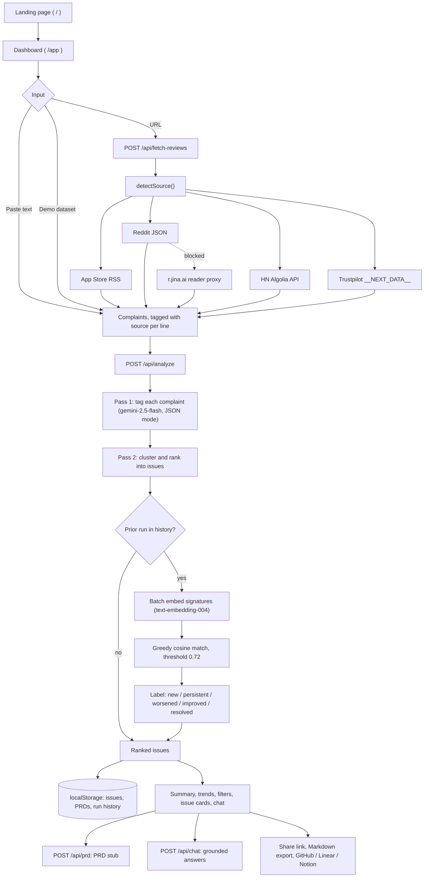

<div align="center">

# BuildMonday

**Turn a pile of customer complaints into a ranked list of what engineering should build on Monday.**

Paste complaints or point it at an App Store, Reddit, Hacker News or Trustpilot URL. Two Gemini passes tag, cluster and rank them into engineering issues with evidence, effort, churn risk and a one-line reason for every ranking.

[](https://build-monday.vercel.app)


[Live demo](https://build-monday.vercel.app) · [How it works](#how-it-works) · [Engineering decisions](#engineering-decisions) · [Getting started](#getting-started)

</div>

---

## Why

Founders and PMs already know customers are unhappy. The complaints are scattered across app-store reviews, Reddit threads, Hacker News comments and support text, and turning them into an engineering decision is slow, manual work:

- Which problem is it, really, once you group the duplicates?
- How often does it come up, and where?
- How much churn risk does it carry?
- How much effort is the fix?
- Why does it rank above the next one?

BuildMonday automates the tagging, clustering, ranking and PRD drafting. It also remembers the previous run, so you can see which issues are new, which got worse, which improved and which went away.

## Features

**Ingestion**
- **Two input modes:** paste text (one complaint per line) or fetch from a URL.
- **Four live sources**, parsed server-side in [`app/api/fetch-reviews/route.ts`](app/api/fetch-reviews/route.ts):
  - **Apple App Store** customer-reviews RSS (1 to 3 star reviews only)
  - **Reddit** threads (the post plus its top-level comments) and subreddits (`top.json`, NSFW posts filtered), with a reader-proxy fallback when the direct request fails
  - **Hacker News** threads through the Algolia items API, with a recursive comment walk
  - **Trustpilot** pages, parsed from `__NEXT_DATA__` (1 to 3 stars)
- Each fetch is capped at 50 reviews. Every line keeps its source so provenance survives the whole pipeline.
- **Three demo datasets** (E-commerce, SaaS Tool, Food Delivery, 20 complaints each) for a zero-setup try.

**Analysis**
- **Two-pass LLM pipeline:** pass 1 tags every complaint (category, severity, churn signal, segment, urgency keywords, source). Pass 2 clusters the tagged set into ranked issues with `priority_score`, effort (S/M/L), evidence quotes, a recommended action (`fix_now`, `investigate`, `monitor`), a one-sentence `ranking_reason` and a per-source `source_mix`.
- **On-demand PRD stubs** per issue: problem statement, affected users, acceptance criteria, edge cases, success metrics, implementation notes and complexity.
- **Run-over-run diff:** each cluster is matched to the previous run with embeddings and labelled **new**, **persistent**, **worsened** or **improved**. Clusters that did not come back are listed under "Resolved since last run".
- **Trend sparklines** across up to 10 stored runs for the top 6 clusters.
- **Grounded chat** ("Ask about these issues"): answers only from the current analysis and cites clusters as `#N`.

**Workflow**
- Per-issue status (`backlog`, `in_progress`, `shipped`). Shipped issues sink to the bottom.
- Filter by action, status and source. Sort by priority, frequency or severity.
- Summary bar with counts per action and a rough sprint estimate.
- "Add more complaints" appends new input and re-runs the analysis.

**Hand-off**
- **Shareable link:** results are LZ-string compressed into a `?results=` URL. No backend involved.
- **Markdown export** of the full report (copy or download a `.md` file).
- **Send to** GitHub (prefilled new-issue link), Linear (Markdown on the clipboard, workspace opened) or Notion (rich HTML on the clipboard, `notion.so/new` opened).

## How it works



Step by step:

1. **Input.** The client either uses pasted text or a demo dataset, or posts a URL to `/api/fetch-reviews`. `detectSource()` matches the URL against patterns for App Store, Trustpilot, HN items, Reddit threads, subreddits (including bare `r/name`) and bare App Store IDs, then calls the matching fetcher. The client records each line's source.
2. **Analyze.** The client sends `{ complaintsTagged, priorIssues, priorRunDate }` to `/api/analyze`. The prior run is the latest entry in local history.
3. **Pass 1.** `PASS_1_PROMPT` returns a `TaggedComplaint[]` in Gemini's JSON mode.
4. **Pass 2.** `PASS_2_PROMPT` clusters the tagged JSON into `Issue[]`. The server sorts again by `priority_score`.
5. **Diff.** If a prior run exists, a signature (title plus the first 3 evidence quotes, capped at 1,500 chars) is built for every current and prior cluster. All of them are embedded in one `batchEmbedContents` call, matched one-to-one by cosine similarity, and classified by frequency delta. If this step fails, the error is caught and the analysis still returns.
6. **Render and persist.** Issues, PRDs, statuses and a capped run history go to `localStorage`, and the dashboard renders.
7. **On demand.** "Generate PRD" calls `/api/prd`. The chat panel calls `/api/chat` with the current issues and trimmed history.

## Engineering decisions

| Decision | Where | Why it matters |
| --- | --- | --- |
| **Tag first, then cluster** | [`app/api/analyze/route.ts`](app/api/analyze/route.ts), [`lib/prompts.ts`](lib/prompts.ts) | Ranking runs over normalized fields (severity, churn signal, segment) instead of raw prose, and each complaint's source travels through both passes into `source_mix`. |
| **Embeddings for the diff** | `computeDiff` in [`app/api/analyze/route.ts`](app/api/analyze/route.ts), [`lib/embeddings.ts`](lib/embeddings.ts) | Cluster titles change wording between runs. Matching on title plus evidence with `text-embedding-004` (`SEMANTIC_SIMILARITY` task type) catches the same issue under a new name. One batched call covers every signature. |
| **Best-effort diff** | same | The diff is a bonus, not a dependency. An embedding failure is caught, and the core analysis is still returned. |
| **Two similarity methods** | [`components/TrendsChart.tsx`](components/TrendsChart.tsx) | Precise embeddings for the one diff that matters (against the last run). Cheap client-side token Jaccard on titles (threshold 0.35) for multi-run sparklines, with no extra API calls. |
| **Scraping that degrades gracefully** | [`app/api/fetch-reviews/route.ts`](app/api/fetch-reviews/route.ts) | Reddit is tried directly with a browser user agent, then through the `r.jina.ai` reader (a code comment notes Reddit blocks Vercel datacenter IPs), with line filters and dedupe for markdown noise, URLs and vote counts. Trustpilot reviews are found by a depth-limited recursive search of `__NEXT_DATA__` for `{text, rating}` arrays. HN comments are walked recursively with HTML stripped. Each source returns a specific error message. |
| **Grounded chat** | [`app/api/chat/route.ts`](app/api/chat/route.ts) | The whole cluster analysis is serialized into the system instruction with rules to cite `#N` and not invent complaints, frequencies or segments. History is trimmed to the last 6 turns to bound token use. |
| **Tolerant JSON parsing** | `safeParse` in [`lib/gemini.ts`](lib/gemini.ts) | JSON mode is requested. If parsing still fails, code fences are stripped and parsing is retried. |
| **No backend state** | [`lib/share.ts`](lib/share.ts), [`lib/storage.ts`](lib/storage.ts) | Share links carry the results themselves (`compressToEncodedURIComponent`, versioned payload, PRDs left out). History, statuses and integration settings live in 4 `localStorage` keys behind SSR-safe guards with try/catch around quota errors. |
| **Integrations without OAuth** | [`lib/integrations.ts`](lib/integrations.ts), [`components/SendToMenu.tsx`](components/SendToMenu.tsx) | GitHub gets an `issues/new` deep link built with `URLSearchParams` (body truncated at 6,000 chars), and a lenient parser accepts `owner/repo`, full URLs or `.git` suffixes. Notion gets a multi-MIME `ClipboardItem` (`text/html` + `text/plain`) so a paste keeps headings and lists. |

### AI at a glance

| | |
| --- | --- |
| Provider | Google Gemini via `@google/generative-ai` |
| Generation model | `gemini-2.5-flash` (JSON mode, temperature 0.4; chat at 0.6) |
| Embedding model | `text-embedding-004` |
| Calls per analysis | 2 sequential generation calls, plus 1 batched embedding call when a prior run exists |
| Calls per PRD / chat message | 1 each |
| Prompts | 3 templates in `lib/prompts.ts` (`PASS_1_PROMPT`, `PASS_2_PROMPT`, `PRD_PROMPT`) and 1 dynamic chat system instruction |

### Tunable constants

| Constant | Value | Location |
| --- | --- | --- |
| Embedding match threshold | `0.72` | `app/api/analyze/route.ts` |
| Trends title Jaccard threshold | `0.35` | `components/TrendsChart.tsx` |
| Sparklines tracked | `6` | `components/TrendsChart.tsx` |
| Stored runs | `10` | `lib/storage.ts` |
| Chat history | `6` turns | `app/api/chat/route.ts` |
| Reviews per fetch | `50` | `app/api/fetch-reviews/route.ts` |
| GitHub issue body limit | `6000` chars | `lib/integrations.ts` |
| Route `maxDuration` | analyze 60s, prd 60s, chat 30s, fetch-reviews 30s | `app/api/*/route.ts` |

## Tech stack

| Layer | Choice |
| --- | --- |
| Framework | Next.js 14.2 (App Router), React 18 |
| Language | TypeScript 5 |
| AI | `@google/generative-ai` (Gemini 2.5 Flash, text-embedding-004) |
| Styling | Tailwind CSS 3.4, `clsx`, `tailwind-merge` |
| Motion and effects | Framer Motion 12, tsParticles (sparkles on `/app`), a WebGL2 smoke shader on the landing page |
| Sharing | `lz-string` |
| Persistence | Browser `localStorage` (no database, no auth) |
| Hosting | Vercel |

## Getting started

**Prerequisites:** Node.js 18.17 or newer (required by Next.js 14) and a Gemini API key from [Google AI Studio](https://aistudio.google.com/app/apikey).

```bash
git clone https://github.com/ritvikjaiswal02/BuildMonday.git
cd BuildMonday
npm install
cp .env.local.example .env.local   # then add your GEMINI_API_KEY
npm run dev
```

Open [http://localhost:3000](http://localhost:3000) for the landing page, or go straight to [http://localhost:3000/app](http://localhost:3000/app). Pick a demo dataset to try it without collecting any data.

| Script | Command | What it does |
| --- | --- | --- |
| `npm run dev` | `next dev` | Start the dev server |
| `npm run build` | `next build` | Production build |
| `npm run start` | `next start` | Serve the production build |
| `npm run lint` | `next lint` | Run ESLint through Next.js. No ESLint config or `eslint` dependency is committed yet, so the first run prompts you to set one up. |

### Environment variables

| Variable | Required | Used by | Description |
| --- | --- | --- | --- |
| `GEMINI_API_KEY` | Yes | `lib/gemini.ts`, `lib/embeddings.ts` | Google Gemini key, shared by generation and embeddings. Server-side only. |

## Project structure

```text
BuildMonday/
├── app/
│   ├── page.tsx                    # "/" marketing landing (renders components/Landing)
│   ├── app/page.tsx                # "/app" dashboard: state, filters, history, share, export
│   ├── layout.tsx                  # root layout, Google Fonts, metadata
│   ├── globals.css
│   └── api/
│       ├── analyze/route.ts        # 2-pass tag + cluster/rank, embedding diff vs prior run
│       ├── prd/route.ts            # PRD stub generation
│       ├── chat/route.ts           # grounded chat over the current clusters
│       └── fetch-reviews/route.ts  # App Store / Reddit (+ reader proxy) / HN / Trustpilot
├── components/                     # 16 feature components
│   ├── InputPanel.tsx  IssueCard.tsx  PrdSection.tsx  SendToMenu.tsx
│   ├── ChatPanel.tsx   TrendsChart.tsx  FilterBar.tsx  SummaryBar.tsx
│   ├── DiffBadge.tsx   SourceMixBadge.tsx  StatusSelector.tsx  Landing.tsx  ...
│   └── ui/                         # sparkles (tsParticles), smoke shader (WebGL2), animated underline
├── lib/
│   ├── gemini.ts                   # Gemini client, JSON-mode + chat calls, tolerant parse
│   ├── embeddings.ts               # batch embeddings + cosine similarity
│   ├── prompts.ts                  # PASS_1, PASS_2, PRD prompt templates
│   ├── types.ts                    # Issue, TaggedComplaint, PrdStub, diff and history types
│   ├── storage.ts                  # localStorage state, statuses, history (10 runs)
│   ├── share.ts                    # LZ-string share-link encode/decode
│   ├── markdown.ts                 # report/PRD Markdown and HTML builders
│   ├── integrations.ts             # GitHub/Linear parsing, issue URL builder, saved config
│   ├── demo-data.ts                # 3 demo datasets x 20 complaints
│   └── utils.ts                    # cn() class helper
├── .env.local.example
├── next.config.mjs  tailwind.config.ts  postcss.config.js  tsconfig.json
└── package.json
```

## Deployment

The app is built for Vercel and runs at **[build-monday.vercel.app](https://build-monday.vercel.app)**.

1. Import the repository in Vercel. The Next.js preset needs no extra config (there is no `vercel.json`).
2. Add `GEMINI_API_KEY` under Project Settings, Environment Variables.
3. Deploy.

Notes:
- All four API routes use the Node.js runtime and set `maxDuration` (60s for analyze and PRD, 30s for chat and fetching). Long analyses need a plan that allows 60-second functions.
- Reddit often blocks datacenter IPs, which is why the fetcher falls back to the `r.jina.ai` reader proxy.
- There is no server-side storage. History and statuses live in each visitor's browser, and share links carry their data in the URL.

## Known limitations

Stated plainly, so nobody has to find them the hard way:

- No automated tests and no committed ESLint setup yet.
- LLM output is not schema-validated. Constraints such as "`source_mix` sums to frequency" are enforced only by the prompt.
- No retries on Gemini errors. A failed call returns a 500.
- Trustpilot reviews are labelled `manual` in `source_mix` because the `Source` type has no Trustpilot value.
- History lives in one browser, so it does not follow you across devices.

## Roadmap

Possible next steps, not yet built:

- [ ] Schema validation for model output (for example with Gemini `responseSchema` or zod) plus retry on malformed JSON
- [ ] A first-class `trustpilot` source and more sources (Google Play, G2, support-desk exports)
- [ ] Unit tests for `detectSource`, `computeDiff`, share encoding and the integration URL builders
- [ ] Optional synced storage so history and statuses work across devices and teammates
- [ ] API-based GitHub and Linear issue creation for teams that want it
- [ ] Scheduled re-fetching of a saved source to track issues week over week

## Author

**Ritvik Jaiswal**: [github.com/ritvikjaiswal02](https://github.com/ritvikjaiswal02)

If BuildMonday is useful to you, a star on the [repo](https://github.com/ritvikjaiswal02/BuildMonday) is appreciated. Issues and pull requests are welcome.
